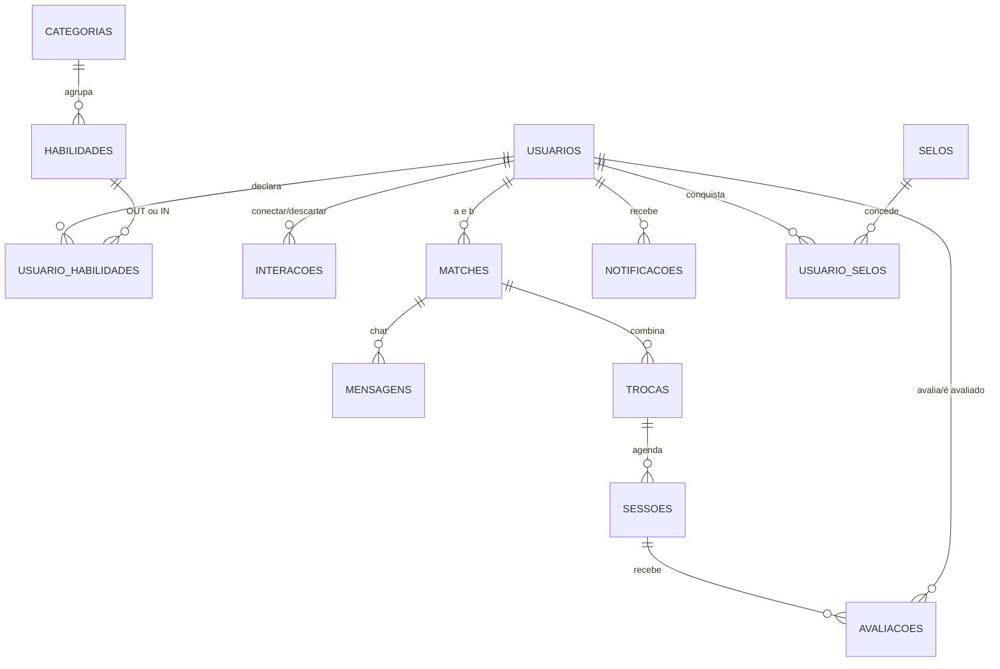

# Troc.ai – Banco de Dados (Back-end: O Banco)

Responsável: Daphiny

Camada de dados do Troc.ai (Tinder do Conhecimento): modelagem relacional, regras de integridade no próprio banco, 5 perfis de demonstração e testes.
Tecnologia: SQLite 3 + Python 3.8+ (biblioteca padrão)

execução

```bash
cd banco
python banco.py          cria trocai.db, com 5 perfis e mostra o match do Lucas
python -m unittest -v    alguns testes
```

 Arquivos

| Arquivo | Função |
|---|---|
| `schema.sql` | Tabelas, restrições, triggers e views |
| `dados_iniciais.sql` | Categorias, habilidades e selo inicial |
| `banco.py` | Repositório (funções que a API chama) + dados demo |
| `testes.py` | 28 testes das regras de negócio |

Modelo de dados (ER)



Mapeamento com as telas da 1ª entrega

| Telas | Tabelas / funções |
|---|---|
| 01–02 Login e cadastro | `usuarios`, `criar_usuario`, `autenticar` (senha com PBKDF2) |
| 03–06 Perfil e skills | `usuario_habilidades` (OUT/IN), `definir_habilidades`, `obter_perfil` |
| 07–08 Feed e perfil compatível | `v_afinidade_skills`, `sugestoes`, `buscar_perfis` (filtros) |
| 09 Match | `interacoes`, `matches`, `registrar_interacao` (só com aceite mútuo) |
| 10–11 Chat e troca | `mensagens`, `trocas`, `enviar_mensagem`, `definir_troca` |
| 12–13 Sessão | `sessoes`, `agendar_sessao`, `concluir_sessao` |
| 14–15 Avaliação e reputação | `avaliacoes`, `v_reputacao`, `selos`, `avaliar`, `reputacao` |
| Notificações | `notificacoes`, `gerar_notificacoes_afinidade` |

Regras  no banco

- Perfil ativo no algoritmo: mínimo de 3 Skills Out e 1 Skill In 
- Uma habilidade não pode ser ensinada e desejada ao mesmo tempo.
- Match só existe com aceitação mútua (par ordenado, sem duplicidade).
- Chat só para os dois participantes de um match.
- Na troca, cada pessoa só pode ensinar o que declarou em Skills Out.
- Avaliação (nota 1–5) só após sessão concluída, uma por pessoa/sessão, apenas entre participantes.
- Ao concluir a primeira sessão, os dois ganham o selo Primeira Permuta Concluída
- Senhas nunca em texto puro; e-mails únicos (sem diferenciar maiúsculas).

 Índice de Afinidade

```
skills     = média( demanda de A atendida por B , demanda de B atendida por A ) × 100
proximidade = 100 (mesma zona) | 80 (mesma cidade) | 50 (cidades diferentes)
afinidade  = 0,9 × skills + 0,1 × proximidade
```

Lucas × Marina: skills 100% + zonas diferentes (80) = 98%, como Quadro 3 do documento.

 Usando na API (exemplo)

```python
from banco import conectar, sugestoes, registrar_interacao, enviar_mensagem

conn = conectar()
feed = sugestoes(conn, usuario_id=1045)                   
r = registrar_interacao(conn, 1045, 1046, "CONECTAR")    
if r["match"]:
    enviar_mensagem(conn, r["match_id"], 1045, "Oi, Marina!")
```

Perfis de demonstração (senha de todos: `senha123`)

| ID | Nome | Oferece (Out) | Quer aprender (In) |
|---|---|---|---|
| 1045 | Lucas Andrade | Python, Hardware, Office, Lógica, Prog. Básica, HTML/Web | UI Design, Figma, Design Gráfico, Photoshop |
| 1046 | Marina Costa | Design Gráfico, UI Design, Figma, Photoshop, Illustrator, Identidade Visual | Hardware, Prog. Básica, HTML/Web |
| 1047 | Maria Oliveira | UX Design, UI Design, Figma | Python, SQL, Inglês, Cloud |
| 1048 | Beatriz Ferreira | Inglês, Office, Design Gráfico | Power BI, Excel Avançado |
| 1049 | Pedro Henrique | Power BI, Excel Avançado, SQL, Python | Inglês, Design Gráfico |
